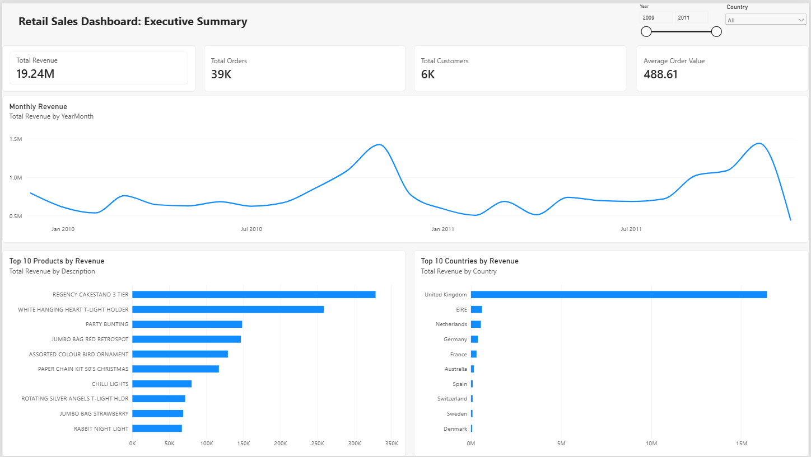
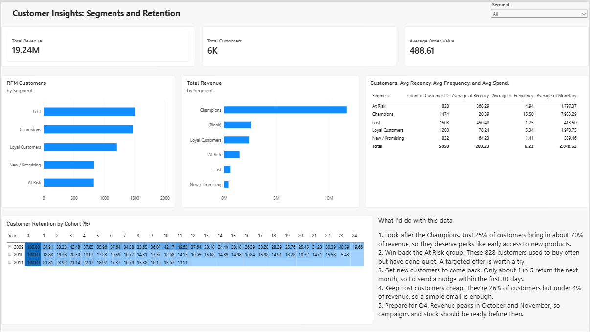

# Retail Sales & Customer Analytics

Python data cleaning, RFM segmentation, cohort retention analysis, and a 2-page Power BI dashboard
built on 1M+ online retail transactions.

## Business Problem
An online gift retailer wants to know where its revenue comes from, which customers matter most,
and how well it keeps them. This project cleans the raw transaction data, answers those questions,
and turns the results into recommendations.

## Tools Used
Python (pandas, NumPy, Matplotlib, Seaborn), SQL (SQLite), Power BI, Jupyter, Git

## Dataset
[Online Retail II (UCI)](https://archive.ics.uci.edu/dataset/502/online+retail+ii): UK-based online
retailer transactions from Dec 2009 to Dec 2011 (1,067,371 rows, 8 columns).

## Data Cleaning
| Issue | Before | After |
|---|---|---|
| Total rows | 1,067,371 | 1,001,809 |
| Missing Description | 4,382 | 0 |
| Exact duplicate rows | 34,335 | 0 |
| Quantity <= 0 | 22,950 | 0 |
| Price <= 0 | 6,207 | 0 |
| Cancelled invoices | 19,494 | 0 (kept in a separate table) |

**Key decisions**
- Removed exact duplicates, invalid quantities and prices, and non-product codes (POST, DOT, M, etc.).
- Kept rows with no Customer ID (about 22%) for revenue analysis, and excluded them only from
  customer-level analysis (RFM and cohorts).
- Spotted that a few giant orders (like 80,995 units of one product) were data-entry mistakes cancelled
  within minutes. I removed any sale cancelled within 24 hours by the same customer for the same
  product and quantity, which took out about 404K of inflated revenue.
- Overall, 65,562 rows (6.14%) were removed.

## Key Findings
- Total revenue is about 19.24M from 39,374 orders and 5,850 identified customers.
  Average order value is 488.61.
- The UK accounts for about 85% of revenue.
- Revenue peaks every October to November.
- 72.29% of customers placed more than one order.
- The cancellation rate is 17.40%.
- **25% of customers (Champions) generate about 70% of revenue.**
- About 1 in 5 customers return the month after their first purchase (20.9% on average).

## Dashboard
### Page 1: Executive Summary


### Page 2: Customer Insights


## Customer Segmentation (RFM)
Each customer was scored from 1 to 5 on Recency, Frequency, and Monetary value, then grouped into segments.

| Segment | Customers | % of customers | % of revenue |
|---|---|---|---|
| Champions | 1,474 | 25.2% | 70.3% |
| Loyal Customers | 1,208 | 20.6% | 14.3% |
| At Risk | 828 | 14.2% | 8.9% |
| Lost | 1,508 | 25.8% | 3.7% |
| New / Promising | 832 | 14.2% | 2.7% |

## Cohort Retention
Customers were grouped by the month of their first purchase and tracked month by month.
Average retention is about 21% one month after the first purchase and stays around 15 to 20% afterwards,
which points to a loyal core of repeat buyers.

## Recommendations
1. **Look after the Champions.** A quarter of customers bring in about 70% of revenue, so loyalty perks or
   early access would be a cheap way to keep them.
2. **Win back At Risk customers.** There are 828 of them. They used to buy often but have gone quiet,
   so a targeted offer makes sense.
3. **Push new customers toward a second purchase.** Only about 1 in 5 come back the next month,
   so the first 30 days matter most.
4. **Don't spend much on Lost customers.** They are 26% of customers but under 4% of revenue.
5. **Plan for Q4.** Sales peak in October and November, so promotions and stock should be ready earlier.

## SQL Validation
I loaded the clean data into SQLite and rebuilt the main KPIs with SQL (revenue, orders, top products
and countries, repeat rate, revenue by segment). The results match the Python and Power BI numbers.
Queries are in [`sql/queries.sql`](sql/queries.sql).

## Limitations
- The Dec 2009 cohort includes customers who had already bought before the data starts, so it looks
  better than a truly new cohort.
- Dec 2011 has only 9 days of data, so its drop in revenue is not a real decline.
- About 22% of rows have no Customer ID, so customer-level results cover only the identified customers.
- The 24-hour cancellation rule is my own judgement call, not an official definition of a mistake.

## Project Structure
```
retail-sales-analytics/
├── data/
│   ├── raw/          (original dataset, not uploaded)
│   └── processed/    (clean data and outputs, not uploaded)
├── notebooks/
│   ├── 01_data_cleaning.ipynb
│   ├── 02_analysis.ipynb
│   └── 03_sql_validation.ipynb
├── sql/
│   └── queries.sql
├── dashboard/
│   └── retail_dashboard.pbix
├── images/
└── README.md
```

## How to Run
1. Download the dataset from the link above and save it as `data/raw/online_retail_II.csv`.
2. Install the libraries: `pip install -r requirements.txt`
3. Run the notebooks in order: 01, 02, 03.
4. Open `dashboard/retail_dashboard.pbix` in Power BI Desktop. If it asks for the data,
   point it to the files in `data/processed/`.

## Author
**Dilna Joseph** | [LinkedIn](https://www.linkedin.com/in/dilna-joseph-b46425313/) | [GitHub](https://github.com/dilna06)